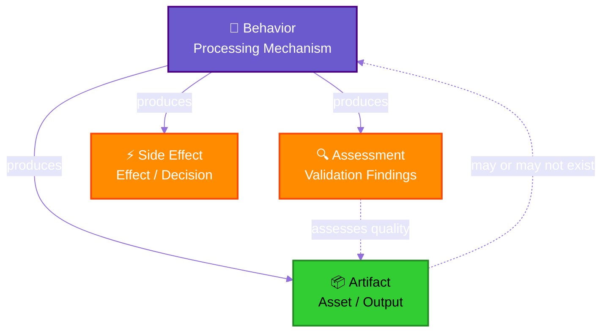
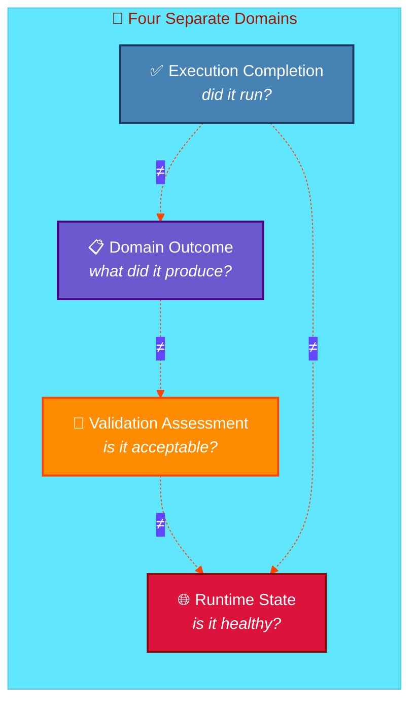
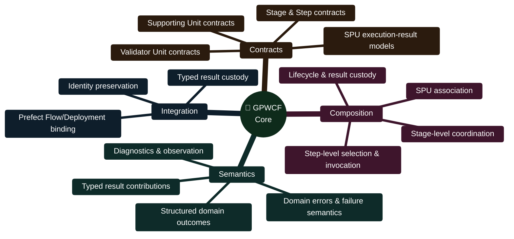
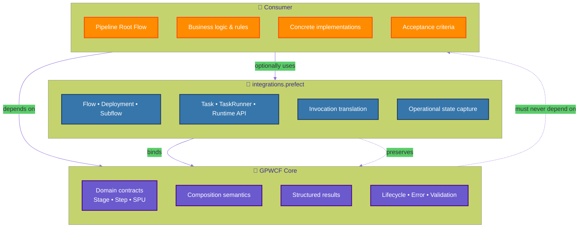
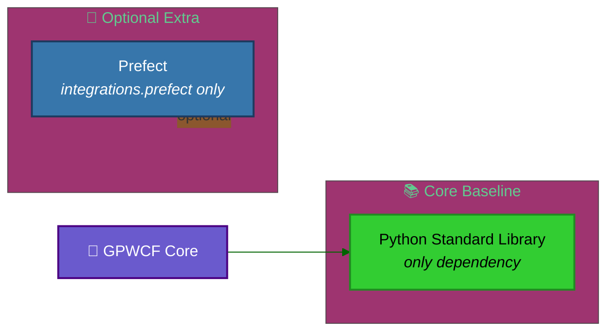
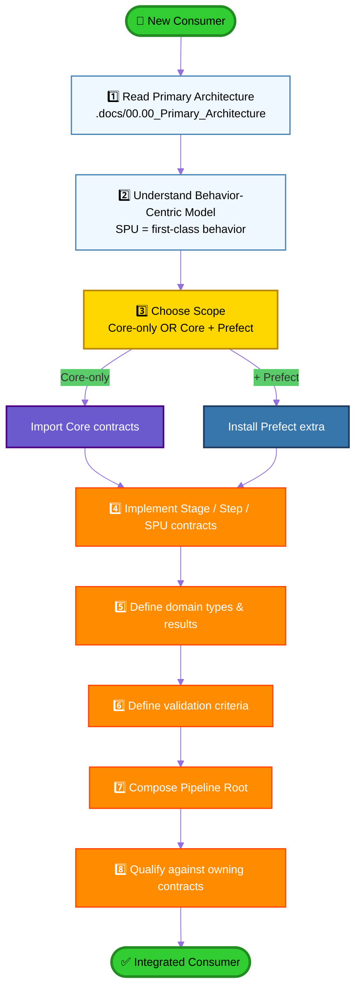

# 🧬 GPWCF

### Generic Pipeline and Workflow Components Framework

**A behavior-centric, reusable Python framework for defining, composing, specializing, and coordinating workflow components.**

---

## 📖 Overview

**GPWCF** is an independent, reusable, **behavior-centric** Python framework that treats *processing mechanisms and behaviors* as first-class reusable units. Data assets and other artifacts are **possible outputs** of those behaviors — **not** the exclusive organizing concept of the framework.

> [!IMPORTANT]
> GPWCF is **independent of any particular consumer application**.
> `SMRB.PayloadDescriptionGenerator` is the **first intended consumer** — *not* the owner or architectural definition of GPWCF.

The framework provides domain-level contracts and reusable capabilities for:

| Component | Role |
| :--- | :--- |
| 🎭 **Stages** | Top-level composition boundaries coordinating Steps |
| 🪜 **Steps** | Composition boundaries selecting, associating, and invoking Processing Units |
| ⚙️ **Step Processing Units (SPUs)** | Reusable, specialized processing behaviors |
| 🛡️ **Supporting Units** *(optional)* | Validation, error handling, observation responsibilities |
| 📊 **Structured Outcomes** | Typed domain results distinct from external runtime states |

---

## 🏛️ Architectural Philosophy

### 🎯 Behavior-Centric Workflow Framework

> [!NOTE]
> **Principle:** The *behavior* is a first-class unit of value and reuse.
> A data asset, file, description, report, decision, or validation finding **may be produced** by that behavior — but **a data asset is not required** for the behavior to be meaningful.

### 🚫 Dagster Position

GPWCF **does not** adopt an **Asset-centric orchestration model** as its foundational abstraction, and **does not require Dagster**.

Asset cataloguing, lineage, materialization, and data-asset lifecycle management are **not** assumed to be universal GPWCF responsibilities.

---

## 🧩 Outcome & Assessment Model

### ⚠️ Four Distinct Concepts — Never Collapsed

> [!WARNING]
> **A behavior may execute successfully while its output is invalid, non-conforming, unsupported, incomplete, or otherwise unacceptable** under the applicable validation rules.

| Concept | Description | Owner |
| :--- | :--- | :--- |
| **Structured Outcomes** | Typed, structured domain result contracts at Stage / Step / SPU boundaries | GPWCF contracts + consumer specialization |
| **Validation** | Validator Units assess outputs against explicit criteria | Consumer-defined criteria |
| **Error / Failure Semantics** | Domain errors, invocation failures, handling results, validation findings | Distinguished per owning contract |
| **Runtime State** | External orchestration state (e.g., Prefect states) | External runtime |

> [!TIP]
> GPWCF **does not impose** one universal consumer error taxonomy or acceptance policy. It supplies *generic contracts and coordination boundaries*; consumers supply *specialized behavior, criteria, and business interpretation*.

---

## 📐 Architectural Scope

### ✅ What GPWCF Provides

**Provided Capabilities:**

- 🏗️ **Programmatic contracts & implementations** for Stage and Step components
- 🎼 **Stage-level composition** — coordinating Steps within a Stage
- 🎬 **Step-level composition** — selecting, associating, invoking, coordinating Processing Units
- ⚙️ **SPU contracts & execution-result models** — reusable specialized behaviors
- 🛡️ **Supporting Units** — validation, error handling, observation (optional)
- 📊 **Structured domain outcomes** — distinct from external runtime states
- 🔍 **Validator Units** — assessing outputs against explicit criteria
- 🩺 **Diagnostics, domain errors, error-handling coordination**
- 🔗 **Common coordination contracts** — association, composition, lifecycle, result custody
- 🚀 **Prefect integration** — binding Stage to Prefect-native Flow/Deployment
- 🧬 **Composition & specialization mechanisms** — preserving component responsibilities

---

### 👤 Consumer Responsibilities

```mermaid
%%{init: {'theme':'base', 'themeVariables': {'primaryColor':'#FF8C00','lineColor':'#FF4500'}}}%%
flowchart TD
    C[👤 Consumer]:::consumer
    C --> S1[Select & specialize components]:::task
    C --> S2[Provide concrete PU / SU implementations]:::task
    C --> S3[Define business logic & domain types]:::task
    C --> S4[Compose Stages & Steps]:::task
    C --> S5[Define Pipeline Root & topology]:::task
    C --> S6[Define validation & acceptance rules]:::task
    C --> S7[Choose Prefect profile or Core-only]:::task
    C --> S8[Provide Prefect deployment config]:::task
    C --> S9[Define execution/concurrency/recovery policies]:::task
    C --> S10[Define artifact persistence if needed]:::task

    classDef consumer fill:#FF8C00,color:#fff,stroke:#FF4500,stroke-width:3px
    classDef task fill:#F0F8FF,color:#000,stroke:#4682B4,stroke-width:1px
```

---

### 🚫 Exclusions

> [!CAUTION]
> **GPWCF explicitly does NOT do the following:**

| ❌ Excluded | Reason |
| :--- | :--- |
| Owning / replacing external orchestration (Prefect, etc.) | Runtime orchestration is external |
| Owning consumer's Pipeline Root / business topology | Consumer-owned |
| Implementing `SMRB.PayloadDescriptionGenerator` business logic | Consumer-owned |
| Treating Data Assets as the only first-class entity | Behavior-centric, not Asset-centric |
| Requiring Dagster or Asset orchestration platform | Optional, not foundational |
| Prescribing fixed topology for Stages/Steps/SPUs | Flexible composition |
| Requiring use of every component | Optional composition |
| Universal PU registry / plugin manager / loader | No universal registry |
| Universal business validation / error / retry policy | Consumer-specific |
| Universal workflow framework adapter abstraction | Only explicit integrations |
| Consumer-specific artifact schemas / persistence / lineage | Consumer-owned |

---

## 🌉 Execution & Integration Boundary

### 🏛️ Three-Layer Ownership Model

### 🧬 GPWCF Core Ownership

- **Owns** domain-level Stage, Step, SPU, and Supporting Pattern *contracts*, *identities*, *composition semantics*, *structured result contracts*, and *specialized domain lifecycle / error / validation responsibilities*
- Domain outcomes and results remain **authoritative domain values** — *not inferred from or replaced by* external runtime states

### 🚀 Prefect Integration Ownership

- **Owns** Prefect-native `Flow`, `Deployment`, `Subflow`, `Task`, `TaskRunner`, and runtime API interaction
- **Translates** GPWCF invocations to Prefect-native execution while **preserving** domain identities, invocation contracts, and typed results
- **Captures** Prefect operational states and native identifiers as *separate operational evidence* — correlated with, but **not replacing**, GPWCF domain identities
- **Remains optional** — GPWCF Core contracts remain **importable and usable without Prefect**

> [!IMPORTANT]
> **Prefect-native completion, failure, cancellation, or crash does NOT by itself establish:**
> - ✅ Domain result acceptability
> - ✅ Publication acceptance
> - ✅ Lifecycle release
> - ✅ Safe settlement of domain custody

### 👤 Consumer Ownership

- Owns its **Pipeline Root Flow** and overall workflow topology
- Owns concrete Stage / Step / SPU / Supporting Pattern implementations
- Owns business rules and specialized validation/acceptance criteria
- Selects and configures the Prefect execution profile **when using the optional integration**

> [!TIP]
> **Integration Principle:** GPWCF supplies *reusable behavioral/workflow structure and domain semantics*; Prefect supplies *external runtime orchestration*. The integration **binds** these layers **without transferring domain ownership to Prefect** or **reducing an SPU/behavior to a native Prefect Task**.

---

## 📦 Dependency Management

### 🧪 Environment

| Aspect | Value |
| :--- | :--- |
| **Development Interpreter** | `SMRB` solution shared virtual environment |
| **Path** | `..\.env\Scripts\python.exe` |
| **Python Version** | `3.15.1` |
| **User Site Packages** | `disabled` |
| **Project Requirements** | `requirements.txt` |
| **Solution Aggregator** | `..\requirements.txt` |

### 🔌 Runtime Dependencies

> [!NOTE]
> - **Core implementation baseline** uses the **Python standard library only**
> - **Prefect** is an *optional dependency* of the `integrations.prefect` extra/profile — **NOT** a Core base dependency
> - The framework **does not own or duplicate** a Python runtime

### 🔒 Consumer Isolation

> The framework package **must not depend on** the private dependency bundle, source tree, or implementation details of `SMRB.PayloadDescriptionGenerator` or **any other consumer**.

A consuming application retains **ownership of its runtime and dependency environment**.

---

## 📚 Documentation

| 📁 Section | 📂 Path |
| :--- | :--- |
| 📖 **Root** | `.docs` |
| 🏛️ **Primary Architecture** | `.docs/00.00_Primary_Architecture` |
| 🚀 **Prefect Adoption & Integration** | `.docs/02.00_Prefect_Adoption_Integration Architecture` |
| ⚠️ **Prefect Integration — Environment & Runtime Lessons** | `.docs/00.07_Prefect_Integration_Environment_Runtime_Dependencies_Lessons` |

---

## 📊 Project Status

| 🎯 Area | 📈 Status | 🔍 Notes |
| :--- | :---: | :--- |
| **Identity Established** | ✅ | — |
| **Implementation Capabilities** | 🟡 | *Partially implemented and technically verified.* Core, Prefect integration, packaging, and defined test profiles passed their recorded tests. **Not** a claim that every designed capability or production scenario is qualified. |
| **Prefect Integration** | 🟡 | *Implemented and tested* for defined fixture and same-machine profiles. Production binding of all specialized implementations and advanced failure/recovery scenarios **remain subject to explicit qualification gates**. |
| **Consumer Integration** | ⚪ | *Not yet established.* `SMRB.PayloadDescriptionGenerator` is currently an **implementation-pending consumer skeleton** — it is the first intended consumer, **not** a dependency or architectural owner of GPWCF. |
| **Release Readiness** | 🟡 | Technical implementation evidence exists. **Formal dependency-license review**, Prefect lock release-gate reconciliation, and remaining architecture/operational qualification gates are **tracked separately**. |

> [!WARNING]
> Consult the **owning contracts, acceptance evidence, and open gates** — this status table does not substitute for them.

---

## 🗺️ Consumer Onboarding Map

### 🚀 How to Become a GPWCF Consumer

---

### 🧬 *Behavior is the unit. Assets are the outcome.*

